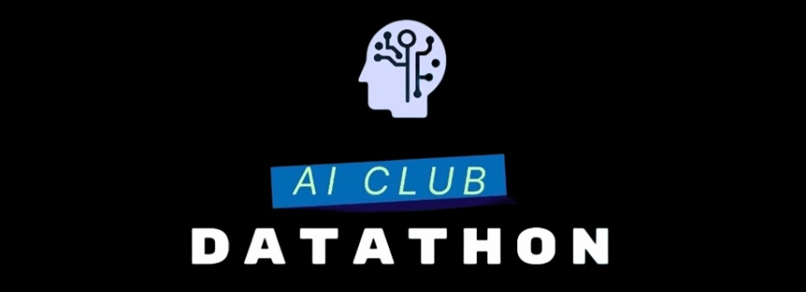

# Hacettepe AI Club - Datathon '26 Official Website 🚀

<div align="center">
  

  <p align="center">
    <strong>Hacettepe Üniversitesi Yapay Zeka Topluluğu Resmi Datathon '26 Web Sitesi</strong><br />
    <em>"Veriyi Geleceğe Dönüştür."</em>
  </p>

  <p align="center">
    <a href="https://nextjs.org"></a>
    <a href="https://react.dev"></a>
    <a href="https://www.typescriptlang.org/"></a>
    <a href="https://tailwindcss.com"></a>
    <a href="https://www.framer.com/motion/"></a>
  </p>

  <p align="center">
    <a href="#-genel-bakış">Genel Bakış</a> •
    <a href="#-tasarım-felsefesi">Tasarım Felsefesi</a> •
    <a href="#-özellikler">Özellikler</a> •
    <a href="#-teknoloji-yığını">Teknoloji</a> •
    <a href="#-kurulum-ve-çalıştırma">Kurulum</a> •
    <a href="#-dağıtım-deploy">Deploy</a> •
    <a href="#-iletişim">İletişim</a>
  </p>
</div>

---

## 📌 Genel Bakış

**Datathon '26**, Hacettepe Üniversitesi Yapay Zeka Topluluğu (Hacettepe AI Club) tarafından düzenlenen, Türkiye genelindeki 25 yaş altı tüm üniversite öğrencilerine (Ön Lisans & Lisans) açık, veri bilimi ve yapay zeka odaklı maratondur.

- **Tarih:** 1 – 15 Aralık 2026
- **Online Etap:** 1 – 14 Aralık 2026 (Kaggle Platformu)
- **Büyük Final:** 15 Aralık 2026 (Hacettepe Üniversitesi Beytepe Kampüsü, Mehmet Akif Ersoy K Salonu, Ankara)
- **Format:** 1 – 3 kişilik takımlar, 2 haftalık yoğun maraton ve jüri sunumları

---

## 🎨 Tasarım Felsefesi

Web sitesi, iki temel tasarım dilinin senteziyle inşa edilmiştir:
1. **Apple.com Ürün Lansmanı Sadeliği:** Asimetrik Bento Grid kart yerleşimi, geniş negatif alanlar, keskin tipografik hiyerarşi, pürüzsüz cam morfizması (`glassmorphism`) ve mikro etkileşimler.
2. **Google Gemini Dinamik Nefes Alan Arka Plan (Breathing Mesh Gradient):** Sabit arka planda 12 saniyelik sonsuz keyframe döngüsü ile yavaşça büyüyüp küçülen 3 adet büyük radyal gradyan küresi (`#1E3A8A` Koyu Lacivert, `#0284C7` Açık Mavi, `#38BDF8` Buz Mavisi) ve 140px bulanıklık altında nefes alan organik ışık derinliği.

---

## ✨ Öne Çıkan Özellikler

### 1. ⏱️ 3D Mekanik Flip Clock (Takvim Yaprağı Sayaç)
- Ortadan ikiye katlanarak dönen (`3D rotateX` perspective) mekanik kartlar.
- **Otomatik 3 Kademeli Durum Yönetimi (State Machine):**
  - **Aşama 1 (1 Aralık öncesi):** `YARIŞMA BAŞLANGICINA KALAN SÜRE` ("Online aşama 1 Aralık 2026'da başlıyor.")
  - **Aşama 2 (1 - 15 Aralık):** `ONLINE GÖREVLENDİRMELER DEVAM EDİYOR • BÜYÜK FİNALE KALAN SÜRE` ("Final: 15 Aralık 2026 • Mehmet Akif Ersoy K Salonu")
  - **Aşama 3 (15 Aralık ve sonrası):** `DATATHON '26 BÜYÜK FİNAL GÜNÜ!`
- Sayfa üzerinde jüri/değerlendiriciler için anlık durum simülasyon araçları.

### 2. 🍱 Apple Bento Grid (Hakkında Bölümü)
- Yuvarlatılmış cam kartlar (`rounded-3xl`, `backdrop-blur-xl`):
  - **Datathon Nedir?** (7 Sütun - Geniş analiz, makine öğrenmesi ve ekip çalışması vurgusu)
  - **Amacımız** (5 Sütun - Türkiye geneli yetenekler ve sektörel network)
  - **Ayırt Edici Özellikler** (6 Sütun - Ankara dışı katılım, multidisipliner yapı, jüri sunumları)
  - **Katılım Koşulları** (6 Sütun - Kontrol listesi ve 25 yaş sınırı)
- **Shimmer / Meteor Efektli TBA Kartları:**
  - *Ödül Havuzu* (Açıklanacak TBA rozeti ve kayan ışık çizgisi)
  - *Jüri Üyelerimiz* (Açıklanacak TBA rozeti ve kayan ışık çizgisi)

### 3. 🗺️ Yarışma Takvimi ve Parlayan Süreç Haritası
- 4 ana aşamayı dikey eksende birleştiren, fare ile üzerine gelindiğinde parlayan interaktif zaman çizgisi:
  1. Başvuru ve Takım Kayıt Süreci (1 Aralık 2026'ya Kadar)
  2. Yarışma Başlangıcı & Online Ön Eleme (1 – 6 Aralık 2026)
  3. Kaggle Yarışma Süreci & Finalistlerin Duyurulması (7 – 13 Aralık 2026)
  4. Büyük Final ve Jüri Sunumları (15 Aralık 2026)

### 4. 🤝 Buzlu Cam Sponsorlar Alanı
- 3x2 kilitli/hareketli yer tutucu iskeletler üzerinde parlayan *"Sponsorlarımız Çok Yakında Açıklanacaktır"* rozeti.
- Kurumsal iş birlikleri için tek tıkla e-posta kopyalama (`contact@hacettepeaiclub.com`) ve `mailto:` bağlantısı.

### 5. 📍 Final Konumu ve Harita Entegrasyonu
- Hacettepe Üniversitesi Beytepe Kampüsü, Mehmet Akif Ersoy K Salonu (`39.8667° K, 32.7339° D`).
- **@vis.gl/react-google-maps** resmi React sarmalayıcısı + özel *Midnight Navy* koyu tema JSON stili.
- Titreşen (pulsing) açık mavi salon pini ve doğrudan Google Haritalar navigasyon butonu.

### 6. 🎉 Kayıt Modalı ve .ics Takvim Dışa Aktarma
- "Kayıt Ol" tıklandığında konfeti kutlamasıyla açılan Apple tarzı cam modal.
- Kaggle başvuru adımları ve Apple/Google takvimlerine eklenebilir tek tıkla `.ics` dosyası oluşturucu.

### 7. 🔝 Floating Scroll to Top Butonu
- Sayfa 350px kaydırıldığında Framer Motion `AnimatePresence` ile yumuşakça beliren cam buton.

---

## 🛠️ Teknoloji Yığını

| Alan | Teknoloji / Kütüphane | Amaç |
| :--- | :--- | :--- |
| **Framework** | [Next.js 15 (App Router)](https://nextjs.org) | Modern SSR, React Server/Client Components |
| **Kütüphane** | [React 19](https://react.dev) | En güncel React çekirdeği |
| **Dil** | [TypeScript](https://www.typescriptlang.org) | Tip güvenliği ve ölçeklenebilirlik |
| **Stil** | [Tailwind CSS v4](https://tailwindcss.com) | Modern yardımcı sınıflar ve özel tema değişkenleri |
| **Animasyonlar** | [Framer Motion](https://www.framer.com/motion) | Scroll-trigger, modal geçişleri ve 3D flip clock |
| **İkonlar** | [Lucide React](https://lucide.dev) | Minimalist, Apple tarzı ince çizgili vektör ikonlar |
| **Harita** | [@vis.gl/react-google-maps](https://github.com/visgl/react-google-maps) | Google Haritalar API v3 ve koyu tema entegrasyonu |
| **Kutlama** | [canvas-confetti](https://github.com/catdad/canvas-confetti) | Kayıt modalında modern konfeti efekti |

---

## 🎨 Renk Paleti

| Değişken Adı | HEX / RGBA Kodu | Kullanım Alanı |
| :--- | :--- | :--- |
| `background_primary` | `#030712` | Ana koyu arka plan (Uzay grisi / Gece) |
| `background_secondary` | `#0A1128` | Derin lacivert alt katman |
| `accent_dark_blue` | `#1E3A8A` | Gemini gradyan küresi 1 |
| `accent_light_blue` | `#38BDF8` | Gök mavisi vurgu & Gemini küresi 3 |
| `accent_cyan_glow` | `#00F5D4` | Camgöbeği neon parıltı & rozetler |
| `glass_surface` | `rgba(15, 23, 42, 0.65)` | Bento Grid cam kart yüzeyi |
| `glass_border` | `rgba(56, 189, 248, 0.20)` | Yarı saydam kart kenarlıkları |

---

## 💻 Kurulum ve Çalıştırma

Projeyi yerel ortamınızda çalıştırmak için aşağıdaki adımları izleyin:

```bash
# 1. Depoyu klonlayın
git clone git@github.com:mbssl/Datathon_Website_AIClub.git
cd Datathon_Website_AIClub

# 2. Bağımlılıkları yükleyin
npm install

# 3. Geliştirme sunucusunu başlatın
npm run dev
```

Tarayıcınızda [http://localhost:3000](http://localhost:3000) adresine gidin.

### Üretim Derlemesi (Production Build)

```bash
# Üretim için derleyin
npm run build

# Üretim sunucusunu çalıştırın
npm run start
```

### Ortam Değişkenleri (Opsiyonel)

Google Haritalar API anahtarını tanımlamak için kök dizinde `.env.local` dosyası oluşturabilirsiniz:

```env
NEXT_PUBLIC_GOOGLE_MAPS_API_KEY="YOUR_GOOGLE_MAPS_API_KEY"
```

> **Not:** API anahtarı tanımlanmadığında dahi yerleşik karanlık mod vektör harita önizlemesi ve navigasyon bağlantısı kusursuz şekilde çalışır.

---

## 🚀 Dağıtım (Deploy)

Bu proje Next.js App Router standartlarına uygun olarak tasarlanmıştır ve tek tıkla Vercel, Netlify veya Docker üzerine konuşlandırılabilir:

### Vercel ile Dağıtım (Önerilen)
1. [Vercel](https://vercel.com) hesabınıza giriş yapın.
2. `mbssl/Datathon_Website_AIClub` GitHub deposunu içe aktarın (Import).
3. Framework olarak **Next.js** otomatik algılanacaktır.
4. **Deploy** butonuna tıklayın.

### GitHub Actions (Opsiyonel CI/CD)
Projede `.github/workflows/deploy.yml` dosyasını yapılandırarak otomatik dağıtım sağlayabilirsiniz.

---

## 📁 Proje Dizin Yapısı

```text
datathon_website/
├── public/
│   └── images/
│       ├── community-logo.png             # Topluluk logosu (logo-lacivert (2).png)
│       └── event-logo.jpg                 # Datathon etkinlik logosu (Picsart_...)
├── src/
│   ├── app/
│   │   ├── globals.css                    # Gemini breathing animasyonları & cam stilleri
│   │   ├── layout.tsx                     # Kök düzen, SEO OpenGraph & fontlar (Inter, Mono)
│   │   └── page.tsx                       # Ana sayfa düzenleyicisi
│   └── components/
│       ├── AboutSection.tsx               # Apple Bento Grid & TBA kartları
│       ├── BreathingBackground.tsx        # Gemini 3-Sphere gradyan arka planı
│       ├── FlipClock.tsx                  # 3D Mekanik takvim yaprağı geri sayım
│       ├── Footer.tsx                     # Topluluk alt bilgi ve sosyal bağlantılar
│       ├── HeroSection.tsx                # Apple stili ana karşılama alanı & CTA
│       ├── Navbar.tsx                     # Sabit yüzen cam navigasyon barı
│       ├── RegisterModal.tsx              # Kayıt rehberi modalı & .ics takvim üretici
│       ├── ScrollToTopButton.tsx          # Yukarı kaydır butonu
│       ├── SponsorsSection.tsx            # Buzlu cam sponsorlar bölümü
│       ├── TimelineSection.tsx            # Parlayan dikey süreç zaman çizgisi
│       └── VenueMapSection.tsx            # Final konumu ve Google Haritalar
├── package.json
├── tsconfig.json
└── README.md
```

---

## 👥 İletişim & Topluluk

- **Organizasyon:** Hacettepe Üniversitesi Yapay Zeka Topluluğu (Hacettepe AI Club)
- **Web Sitesi:** [hacettepeaiclub.com](https://hacettepeaiclub.com)
- **E-posta:** [contact@hacettepeaiclub.com](mailto:contact@hacettepeaiclub.com)
- **Sosyal Medya:**
  - [LinkedIn](https://linkedin.com/company/hacettepeaiclub)
  - [Instagram](https://instagram.com/hacettepeaiclub)
  - [YouTube](https://youtube.com/c/HacettepeAIClub)
  - [X (Twitter)](https://x.com/hacettepeaiclub)

---

<div align="center">
  <sub>Hacettepe Üniversitesi Yapay Zeka Topluluğu © 2026. Tüm hakları saklıdır.</sub>
</div>
